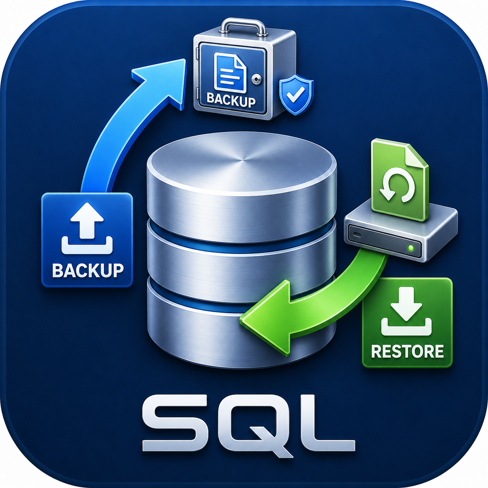

<div align="center">



# SQL Migration Tool

**A portable, version-independent SQL Server database backup and restore utility**

[](https://github.com/praveen-k-prasannan-dev/sql-migration-tool)
[](https://dotnet.microsoft.com)
[](https://www.microsoft.com/sql-server)
[](https://learn.microsoft.com/en-us/dotnet/csharp/)
[](LICENSE)
[](https://github.com/praveen-k-prasannan-dev/sql-migration-tool)

*Completely developed by [Claude AI](https://claude.ai) — Anthropic*

</div>

---

## 📋 Table of Contents

- [Overview](#-overview)
- [Why This Tool?](#-why-this-tool)
- [What's New in 2.0](#-whats-new-in-20)
- [Key Features](#-key-features)
- [Application Screens](#-application-screens)
- [System Requirements](#-system-requirements)
- [Quick Start — Running the App](#-quick-start--running-the-app)
- [Usage Guide](#-usage-guide)
  - [Step 1 — Connect](#step-1--connect-to-sql-server)
  - [Step 2 — Backup](#step-2--backup-a-database)
  - [Step 3 — Restore / Install](#step-3--restore--install-to-target)
- [Script Modes](#-script-modes)
- [Data Options](#-data-options)
- [What Gets Exported](#-what-gets-exported)
- [Install Order](#-install-order)
- [Backup Folder Structure](#-backup-folder-structure)
- [Compatibility with 1.x Backups](#-compatibility-with-1x-backups)
- [Privacy](#-privacy)
- [Building from Source](#-building-from-source)
- [Testing](#-testing)
- [Project Structure](#-project-structure)
- [Creating a Release](#-creating-a-release)
- [Credits](#-credits)
- [License](#-license)

---

## 🌐 Overview

**SQL Migration Tool** is a Windows desktop application that moves a SQL Server database from one server to another — including to an **older** SQL Server version — without compatibility issues.

SQL Server's native `.bak` backup files are **version-locked**: a backup created on SQL Server 2022 cannot be restored to SQL Server 2019. This tool removes that constraint by exporting the database as **portable, human-readable SQL scripts and JSON data files** that can be installed on any SQL Server from 2008 to 2025.

> **No .bak files. No version conflicts. No SSMS required.**

---

## 💡 Why This Tool?

| Problem | Traditional .bak | SQL Migration Tool |
|---|---|---|
| Restore to an older SQL Server | ❌ Not supported | ✅ Works on any version 2008 – 2025 |
| Human-readable output | ❌ Binary format | ✅ Plain SQL scripts + JSON |
| Partial object selection | ❌ All or nothing | ✅ Pick tables, views, procedures, functions, triggers |
| Install into an existing database | ❌ Overwrites everything | ✅ Drop and Create, Create Only, or Create or Alter |
| Existing data on the target | ❌ Replaced | ✅ Skip, truncate and load, append, or upsert |
| See what will happen first | ❌ No | ✅ Install preview |
| Track what was backed up | ❌ No log | ✅ Manifest + progress log + error/warning log |

---

## 🆕 What's New in 2.0

- **Complete schema** — user-defined **table types** and **data types**, schemas, sequences, synonyms, XML schema collections, partition functions and schemes, CHECK and UNIQUE constraints, named defaults, column collations, extended properties and database (DDL) triggers are now exported
- **Exact definitions** — clustered vs nonclustered primary keys, `datetime2`/`time` precision, sparse and ROWGUIDCOL columns, filtered/included/columnstore indexes, indexed views, and disabled or untrusted constraints and triggers are preserved
- **Dependency order** — views, functions and procedures are created after the objects they reference
- **Script modes** — Drop and Create, Create Only, or Create or Alter, chosen at backup and changeable at install
- **Data options** — skip non-empty tables, truncate and load, append, or upsert by key
- **Install preview**, optional **cleanup script**, optional **users, roles and permissions** export
- **Collation and compatibility level** checks against the target
- **Faster, exact data loading** — bulk copy; full date/time and decimal precision (1.x rounded `datetime2` values to ~3 ms)
- **Encrypted saved passwords** — Windows Data Protection instead of Base64
- **Microsoft Store** packaging (MSIX)

---

## ✨ Key Features

### 🔌 Connection Management
- Supports **Windows Authentication** and **SQL Server Authentication**
- **Connection Profiles** — save and recall server/database combinations with one click
- Built-in **Test Connection** with instant feedback
- Saved passwords are **encrypted with Windows Data Protection (DPAPI)** for your Windows account; 1.x profiles are upgraded automatically

### 📦 Backup (Export)
- Selectively export any combination of tables, views, stored procedures, functions and triggers
- Schemas, types, sequences, synonyms and other prerequisites are always included, so the backup installs on an empty database
- **Script mode** chosen per backup (see [Script Modes](#-script-modes))
- Data streamed in **configurable chunk sizes** — each row exported exactly once, without loading whole tables into memory
- Optional **users, roles and permissions** export
- Optional **cleanup script** that removes everything the backup installs from a target
- Live progress log with **✔ / ✘** status per item and a **summary table** by object type

### ▶ Install (Restore)
- Installs in a fixed, dependency-safe order (see [Install Order](#-install-order))
- **Script mode override** — install a backup in a different mode than it was made with
- **Data options** for tables that already have rows (see [Data Options](#-data-options))
- Checks the target's **collation** and **compatibility level** against the source and offers to apply the source's level
- **Preview only** — writes every script exactly as it would run to `preview_install.sql`, changing nothing
- **Bulk-copy** data loading with foreign keys, CHECK constraints and triggers handled around the load
- A failing statement never stops the rest; errors and warnings are shown inline and written to `error.log`
- Abort button to cancel mid-install safely

### 🎨 User Interface
- Animated **splash screen** with progress bar and skip link
- **About** link on every screen (re-opens splash)
- Clean blue/green themed headers per screen
- Resizable backup and install windows
- All forms display the application icon in title bar and taskbar

---

## 🖥 Application Screens

| Screen | Description |
|---|---|
| **Splash Screen** | Animated startup screen with app logo, version, author and progress bar. Skip link available. |
| **Connection** | Enter SQL Server details. Supports Windows and SQL authentication. Save/recall profiles. |
| **Operation** | Choose between BACKUP and INSTALL. |
| **Backup** | Select objects, rows per file, script mode, cleanup script and users/roles/permissions; choose the output folder; run with a live log. |
| **Install** | Load a backup folder and review its manifest; choose script mode, data option and preview; run with dependency-ordered progress. |

---

## 💻 System Requirements

### To Run the Application
| Requirement | Minimum |
|---|---|
| Operating System | Windows 10 version 1809 (x64) or Windows 11 |
| .NET Runtime | **Included** — self-contained build, no separate install needed |
| SQL Server | Any version from 2008 to 2025 (source and/or target) |
| RAM | 256 MB |
| Disk | About 160 MB for the app, plus space for your backup files |

### To Build from Source
| Requirement | Version |
|---|---|
| .NET SDK | 8.0 or later |
| Visual Studio | 2022 or later (recommended), or VS Code with the C# extension |
| Windows | Required (WinForms, win-x64 target) |
| Windows 10/11 SDK | Only to build the Microsoft Store (MSIX) package |

---

## 🚀 Quick Start — Running the App

**Portable ZIP**

1. Download `SqlMigrationTool.zip` from the [Releases](../../releases) page
2. Extract the ZIP to any folder (e.g. `C:\Tools\SqlMigrationTool\`)
3. Double-click **`SqlMigrationTool.exe`**
4. No installation, no admin rights, no .NET install needed

**Microsoft Store** — the Store package is being prepared; see [`SqlMigrationTool/Packaging`](SqlMigrationTool/Packaging/README.md).

---

## 📖 Usage Guide

### Step 1 — Connect to SQL Server

1. The splash screen plays on startup (click **Skip** to dismiss immediately)
2. On the **Connection** screen:
   - Select a saved **Profile** from the dropdown, or enter details manually
   - Enter **Server Name / IP** (e.g. `localhost`, `192.168.1.10`, `(localdb)\MSSQLLocalDB`)
   - Enter **Port** (default `1433`, leave as-is for most setups)
   - Choose **Windows Authentication** (uses your Windows login) or **SQL Server Authentication**
   - Enter the **Database Name**
3. Click **Test Connection** — a green status means you're good to go
4. The connection is saved as a Profile for next time
5. Click **Next ▶** to continue

### Step 2 — Backup a Database

1. On the **Operation** screen, click **📦 BACKUP**
2. On the **Backup** screen:
   - Click **Browse** to choose an output folder
   - Tick the object types to export (Tables, Views, Procs, Functions, Triggers); tick **Users, roles & permissions** to include security
   - Tick/untick individual objects in the list as needed
   - Set **Rows per file** (rows per data file, default 1000)
   - Choose the **Script mode** — the default for installing this backup
   - Optionally tick **Also write a cleanup script**
   - Click **▶ Start Backup**
3. Watch the **progress log** and **summary table** update in real time
4. When complete, the output folder contains everything needed to restore

### Step 3 — Restore / Install to Target

1. Connect to the **target** SQL Server (repeat Step 1 with the target's details)
2. On the **Operation** screen, click **▶ INSTALL**
3. On the **Install** screen:
   - Click **Browse** and select the backup folder created in Step 2
   - Click **Load Manifest** — the panel shows the source, backup format and collation. If the target's collation or compatibility level differs, you are told, and asked whether to apply the source's compatibility level
   - Choose the **Script mode** (preselected from the backup) and the **Data** option
   - Optionally tick **Preview only** to write `preview_install.sql` without installing
   - Click **▶ Start Install**
4. Objects are installed in dependency order automatically
5. Rows marked **✔** succeeded, **!** completed with a warning, **✘** failed — other objects continue to install
6. `error.log` in the backup folder lists every error and warning

---

## 🔁 Script Modes

How the scripts treat objects that **already exist** on the target. Chosen when backing up (stored in the manifest) and changeable when installing — the installer re-wraps the scripts in memory; the backup files are not modified.

| Mode | Views, procedures, functions, triggers | Tables | Table types |
|---|---|---|---|
| **Drop and Create** *(default)* | Dropped and re-created | Dropped and re-created (foreign keys and schema-bound views that block the drop are removed first and re-created from the backup) | Re-created only if their columns differ |
| **Create Only** | Existing ones left untouched | Existing tables and their data left untouched | Left untouched; a warning if they differ |
| **Create or Alter** | Altered in place — permissions are kept | Created when missing; otherwise **missing columns are added** and other differences are reported, never changed | Re-created if their columns differ; procedures using them are dropped and re-created |

Prerequisites (schemas, data types, sequences, synonyms, XML schema collections, partitioning) are always created only when missing.

---

## 📥 Data Options

How data is loaded into a table that **already has rows**. Empty tables are always loaded.

| Option | Behaviour |
|---|---|
| **Skip tables that have rows** *(default)* | The table is not touched; a warning is shown |
| **Truncate and load** | All rows are removed, then the backup's rows are loaded |
| **Append** | All rows are inserted (may fail on duplicate keys) |
| **Upsert** | Rows are matched on the primary key (or first unique key): existing rows are updated, new rows inserted. Tables without a key are skipped if they have rows |

During the load, foreign keys and CHECK constraints involving the loaded tables, and their enabled triggers, are switched off; afterwards they are switched back on in their original state (trusted keys are re-validated). Triggers never fire on restored rows.

---

## 📁 What Gets Exported

| Object Type | What is captured |
|---|---|
| **Schemas** | Every user schema |
| **User-defined data types** | `CREATE TYPE … FROM` alias types |
| **User-defined table types** | Columns, primary key, UNIQUE and CHECK constraints, indexes, memory-optimized option |
| **XML schema collections** | Full schema documents |
| **Sequences** | Definition, and the next value continues where the source left off |
| **Synonyms** | Including references to the database itself, re-pointed to the target |
| **Partitioning** | Partition functions and schemes; partitioned tables keep their scheme |
| **Tables** | Columns with exact types, alias types, collations, identity, computed (persisted), sparse, ROWGUIDCOL, named defaults; PRIMARY KEY (clustered or not), UNIQUE and CHECK constraints including disabled/untrusted state |
| **Data** | All rows as JSON chunk files; `rowversion` and computed columns are regenerated by the server |
| **Views, procedures, functions** | Exact definitions, created in dependency order |
| **Triggers** | DML triggers (disabled state kept) and database DDL triggers |
| **Foreign keys** | Columns, ON DELETE / ON UPDATE actions, NOT FOR REPLICATION, disabled/untrusted state |
| **Indexes** | Clustered, nonclustered, filtered, included columns, columnstore, indexed views, fill factor, compression, lock options, disabled state |
| **Extended properties** | On the database, schemas, objects, columns, parameters, constraints, indexes and types |
| **Security** *(optional)* | Roles, users, role memberships, and GRANT / DENY permissions |

XML, spatial and hash indexes, CLR assemblies and full-text indexes are not exported; they are listed as warnings where they occur.

---

## 🧭 Install Order

| Phase | Contents |
|---|---|
| **0 — Prerequisites** | Schemas, XML schema collections, data types, table types, partitioning, sequences, synonyms |
| **1 — Schema** | Tables, then views, functions and procedures in dependency order |
| **2 — Data** | Table data |
| **3 — Relations** | Foreign keys, indexes, triggers, sequence positions, extended properties, security, and finally database triggers (they could otherwise block the install's own schema changes) |

---

## 🗂 Backup Folder Structure

After a backup, the output folder contains:

```
MyBackup\
├── app_install.config.json        ← Manifest: install order, script mode, source details
├── 00_prerequisites\
│   ├── 001_schemas.sql
│   ├── 002_xml_schema_collections.sql
│   ├── 003_user_defined_data_types.sql
│   └── ...
├── 01_schema\
│   ├── tables\
│   │   ├── 010_dbo_Customers.sql
│   │   └── ...
│   └── programmability\           ← Views, functions and procedures, in dependency order
├── 02_data\
│   └── dbo_Customers\
│       ├── data_001.json
│       └── ...
├── 03_relations\
│   ├── 040_foreign_keys.sql
│   ├── 041_indexes.sql
│   └── ...
├── cleanup_drop_all.sql           ← Only if requested; inert until edited
├── preview_install.sql            ← Written by "Preview only"
└── error.log                      ← Written by each install
```

File numbers follow the install order. All files are **plain text** — you can open, inspect, keep them in source control, or run the scripts yourself in SQL Server Management Studio.

---

## 🔄 Compatibility with 1.x Backups

- Backups made with 1.x install with 2.0 (manifest format 1.0 is still supported), and benefit from the 2.0 installer's data fixes
- Backups made with 2.0 use manifest format 2.0; 1.x cannot install them
- A backup made by a future, newer format is refused with a clear message instead of being half-installed

---

## 🔒 Privacy

SQL Migration Tool collects no data and has no telemetry. It connects only to the SQL Servers you enter. See the [privacy policy](docs/privacy-policy.md).

---

## 🔨 Building from Source

```powershell
# 1. Clone the repository
git clone https://github.com/praveen-k-prasannan-dev/sql-migration-tool.git
cd sql-migration-tool\SqlMigrationTool

# 2. Restore NuGet packages and build
dotnet build -c Release

# 3. Run directly
dotnet run --project SqlMigrationTool -c Release
```

---

## 🧪 Testing

`TestConsole` is a round-trip test harness. It builds a database containing every supported object type (`TestData/full_feature_db.sql`), backs it up, installs it into a fresh database and compares the two catalog by catalog — schema, constraints, indexes, modules, triggers, sequences, security and data checksums. Only databases named `SqlMigTest_*` are ever dropped or created.

```powershell
cd SqlMigrationTool

# Offline checks (GO splitter, password encryption)
dotnet run --project TestConsole -- selftest

# Full round trip against a local SQL Server (Windows authentication)
dotnet run --project TestConsole -- roundtrip --security

# Other options: --mode, --install-mode, --data-mode, --reinstall, --cleanup, --server, --user/--password
dotnet run --project TestConsole
```

---

## 🗃 Project Structure

```
sql-migration-tool\
├── image1.png                          ← Application logo source
├── README.md                           ← This file
├── LICENSE
├── docs\
│   ├── privacy-policy.md               ← Privacy policy (Store listing)
│   └── store-listing.md                ← Microsoft Store listing text
└── SqlMigrationTool\
    ├── SqlMigrationTool.sln
    ├── build.bat                       ← Portable release build
    ├── SqlMigrationTool\               ← Main WinForms project
    │   ├── Program.cs                  ← Entry point & navigation loop
    │   ├── Forms\                      ← Splash, Connection, Operation, Backup, Install
    │   ├── Models\                     ← Manifest, options, script/data modes, object types
    │   ├── Services\
    │   │   ├── BackupService.cs        ← Orchestrates a backup (phases 0–3)
    │   │   ├── SchemaExporter.cs       ← Scripts every object type
    │   │   ├── DependencyResolver.cs   ← Dependency order for views/functions/procedures
    │   │   ├── ScriptWrapper.cs        ← Script modes; re-wraps scripts at install time
    │   │   ├── DataExporter.cs         ← Streams table data to JSON chunks
    │   │   ├── InstallService.cs       ← Orchestrates an install; preview; target checks
    │   │   ├── DataLoader.cs           ← Bulk-copy loading and data options
    │   │   ├── BatchSplitter.cs        ← Splits scripts on GO like sqlcmd
    │   │   ├── CleanupScriptBuilder.cs ← Optional drop-all script
    │   │   ├── ProfileService.cs       ← Saved connection profiles (DPAPI)
    │   │   └── ...
    │   └── Resources\                  ← Application icon and logo
    ├── Packaging\                      ← Microsoft Store (MSIX) build — see its README
    ├── TestData\
    │   └── full_feature_db.sql         ← Test database with every supported object type
    └── TestConsole\                    ← Round-trip test harness and self-tests
```

---

## 📦 Creating a Release

**Portable ZIP** — run `SqlMigrationTool\build.bat`, or:

```powershell
cd SqlMigrationTool
dotnet publish SqlMigrationTool -c Release -r win-x64 --self-contained true -o ..\Release\SqlMigrationTool
Compress-Archive -Path ..\Release\SqlMigrationTool\* -DestinationPath ..\Release\SqlMigrationTool-v2.0.0-win-x64.zip -Force
```

The ZIP is **self-contained** — recipients just extract and run `SqlMigrationTool.exe`. No .NET installation required.

**Microsoft Store (MSIX)**

```powershell
SqlMigrationTool\Packaging\Build-Msix.ps1            # builds Packaging\out\SqlMigrationTool_2.0.0.0_x64.msix
SqlMigrationTool\Packaging\Build-Msix.ps1 -Register  # also installs it locally for testing (Developer Mode)
```

See [`SqlMigrationTool/Packaging/README.md`](SqlMigrationTool/Packaging/README.md) for the Store identity and submission steps.

---

## 👤 Credits

| Role | Name |
|---|---|
| **Created by** | Praveen Kuttathara Prasannan |
| **Developed by** | [Claude AI](https://claude.ai) — Anthropic |
| **Framework** | .NET 8 / Windows Forms |
| **Database Driver** | Microsoft.Data.SqlClient 5.2.1 |

---

## 📄 License

This project is licensed under the **MIT License** — see the [LICENSE](LICENSE) file for details.

```
MIT License  ©  2025  Praveen Kuttathara Prasannan

Permission is hereby granted, free of charge, to any person obtaining a copy
of this software and associated documentation files (the "Software"), to deal
in the Software without restriction, including without limitation the rights
to use, copy, modify, merge, publish, distribute, sublicense, and/or sell
copies of the Software, and to permit persons to whom the Software is
furnished to do so, subject to the following conditions:

The above copyright notice and this permission notice shall be included in all
copies or substantial portions of the Software.

THE SOFTWARE IS PROVIDED "AS IS", WITHOUT WARRANTY OF ANY KIND.
```

---

<div align="center">

Made with ❤️ for the SQL Server community

*If this tool saved you time, consider giving it a ⭐ on GitHub!*

</div>
